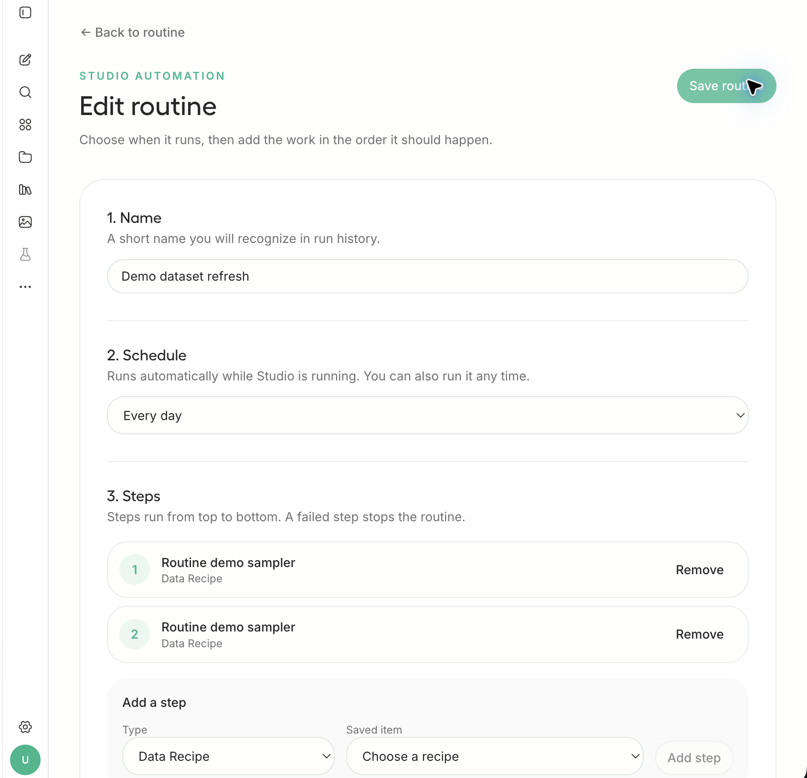
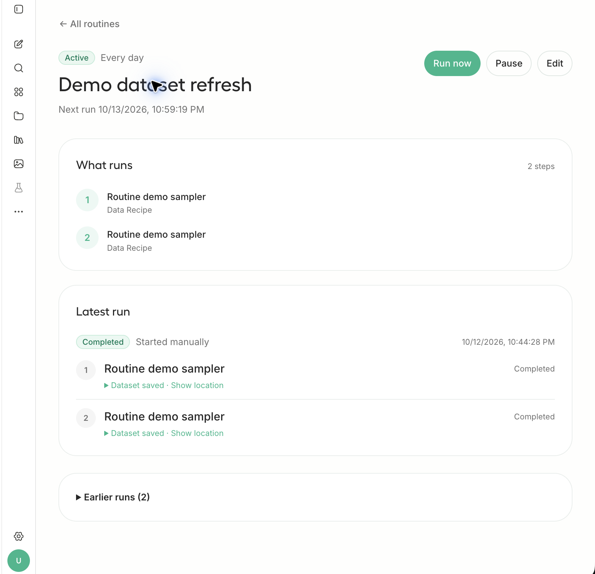

# Studio Routines

Open **Routines** in the Studio sidebar, or go to `/routines` after signing in. The Data Recipes page also links to Routines.

Routines run inside the Studio backend while the Studio process is running. They do not need a system or container cron daemon. Each account has its own routine definitions and run history in `studio.db`.

This first version supports ordered Data Recipe runs and linked-folder syncs. A routine can start manually or at a fixed interval from 15 minutes to one week in the UI. The API accepts intervals from one minute to one week. Each run snapshots its steps, so editing a routine does not change work already queued. One routine run at a time is allowed per account. Failed steps stop the remaining workflow.

The dispatcher advances a due routine atomically and skips missed intervals after downtime. On restart, interrupted runs are marked failed; the next scheduled run proceeds at its saved time. Pausing prevents future scheduled runs and does not cancel an active run. The UI shows each run's step status, error, and available output details.

Data Recipe steps use the existing recipe job API and linked-folder steps use the existing RAG sync queue. Future work can add batch inference, model evaluations, calendar schedules, cancellation, and richer job links without changing the definition/run split.

## Screenshots

